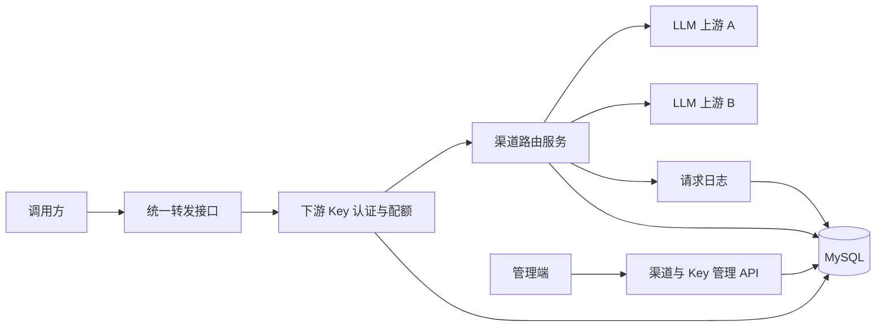

# LLM API Gateway

统一管理多个 LLM 上游渠道，并让调用方通过一个网关地址和下游 API Key 访问模型。

## 解决的问题

直接管理多个模型 API 时会出现几个问题：

- 不同厂商的地址、Key 和模型散落在业务代码中。
- 上游故障后需要人工切换。
- 多个 Key 的调用量和额度难以统一限制。
- 调用失败后缺少统一的日志和用量记录。

本项目用一个 Spring Boot 服务集中处理认证、路由、转发、配额和日志。

## 当前功能

- 上游渠道的新增、查询、修改、启停和删除。
- 下游 API Key 的创建、查询、启停和删除。
- 下游 Key 只保存 SHA-256 摘要，创建时仅返回一次完整 Key。
- 按请求模型筛选可用渠道。
- 基于权重的轮询选择主渠道。
- 上游超时、连接失败、`408`、`429` 和 `5xx` 时切换备用渠道。
- 成功请求按调用次数扣减下游 Key 配额。
- 记录请求状态、上游渠道、延迟和 token 用量。

## 技术栈

| 层级 | 技术 |
|---|---|
| 后端 | Java 17、Spring Boot 3.3.5 |
| 数据访问 | MyBatis-Plus 3.5.12 |
| 数据库 | MySQL 5.7+ |
| 测试 | JUnit 5、Mockito、Spring Boot Test |
| 前端 | Vue 3、Vite、Axios、Lucide |
| 工程化 | Git、GitHub Issue、GitHub Actions |

## 系统结构



请求链路：

```text
POST /v1/chat/completions
  -> 校验下游 API Key
  -> 检查状态、过期时间和配额
  -> 按模型筛选渠道
  -> 按权重选择主渠道
  -> 转发到上游
  -> 失败时按候选顺序切换
  -> 记录日志
  -> 成功后原子扣减配额
```

详细设计见 [docs/design.md](docs/design.md)，接口说明见 [docs/api.md](docs/api.md)。

## 本地启动

### 1. 准备数据库

MySQL 需要一个可连接的用户，并按项目配置提供环境变量：

```text
MYSQL_USERNAME=llm_gateway_app
MYSQL_PASSWORD=llm_gateway_dev
```

使用有建库权限的 MySQL 账号执行初始化脚本：

```bash
mysql -u root -p < backend/src/main/resources/db/schema.sql
```

### 2. 启动后端

```bash
cd backend
mvn spring-boot:run
```

默认地址：`http://localhost:8080`

健康检查：

```bash
curl http://localhost:8080/health
```

### 3. 启动前端

```bash
cd frontend
npm install
npm run dev
```

浏览器打开终端显示的地址，默认是 `http://localhost:5173/`。

### 4. 运行测试

```bash
cd backend
mvn test

cd ../frontend
npm run build
```

没有在 PATH 中安装 Maven 时，可以直接使用 IntelliJ IDEA 自带的 Maven。

## 快速验证

创建本地模拟上游：

```bash
curl -X POST http://localhost:8080/api/channels \
  -H "Content-Type: application/json" \
  -d '{
    "name": "Local Mock",
    "baseUrl": "http://localhost:8080/mock/v1",
    "apiKey": "local-dev-key",
    "model": "mock-model",
    "weight": 1
  }'
```

创建下游 Key：

```bash
curl -X POST http://localhost:8080/api/keys \
  -H "Content-Type: application/json" \
  -d '{
    "name": "Demo Key",
    "quotaAmount": 10
  }'
```

响应中的 `plainKey` 只返回一次，后续请求用它调用网关：

```bash
curl -X POST http://localhost:8080/v1/chat/completions \
  -H "Authorization: Bearer <plainKey>" \
  -H "Content-Type: application/json" \
  -d '{
    "model": "mock-model",
    "messages": [
      {"role": "user", "content": "hello"}
    ]
  }'
```

## 当前进度

- [x] GitHub 仓库与 README
- [x] Spring Boot 后端骨架
- [x] 上游渠道管理
- [x] 下游 API Key 管理
- [x] 统一转发与模拟上游
- [x] 渠道权重路由和失败切换
- [x] 配额控制和请求日志
- [x] 核心单元测试
- [x] Vue 管理后台
- [ ] 流式 SSE 转发
- [ ] CI 状态和部署说明

## 已知边界

- 路由计数器保存在单机内存中，多实例部署时需要迁移到 Redis。
- 当前配额按成功调用次数计算，不按真实 token 费用计算。
- 上游 Key 字段目前是开发环境的明文占位，生产环境需要接入 KMS 或应用层加密。
- 当前转发是同步非流式响应，尚未处理 SSE 中断和断点恢复。
